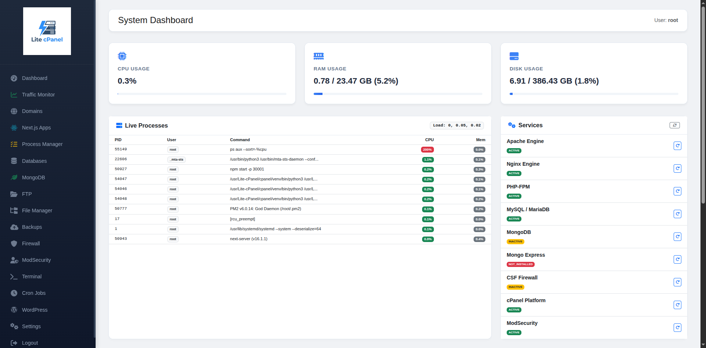

<p align="center">
  
</p>

<h1 align="center">Lite cPanel</h1>

<p align="center">
  A lightweight, open-source web hosting control panel for Linux servers.<br>
  Install a full LAMP/LEMP stack and manage your server from a clean, modern web interface.
</p>

<p align="center">
  
  
  
  
  
</p>

---

## Screenshot



---

## What is Lite cPanel?

**Lite cPanel** is a self-hosted, open-source server management panel built on Python (Flask). It is designed for developers and system administrators who need a simple, fast, and dependency-light alternative to heavy commercial control panels like cPanel/WHM or Plesk.

It bundles a full automated LAMP/LEMP stack installer alongside a browser-based management interface — all in a single deployable unit.

---

## Features

### 🖥️ Dashboard
- Real-time **CPU, RAM, and Disk** usage meters
- **Live Process View** — auto-refreshing top-10 process table with CPU/Memory percentages and 1/5/15-min load averages
- **System Services Monitor** (Admin only) — live status badges (Active / Inactive / Failed / Uninstalled) for Apache, Nginx, PHP-FPM, MySQL, MongoDB, Mongo Express, CSF Firewall, ModSecurity, and Lite cPanel itself
- One-click **Restart** button for each service directly from the dashboard (Admin only)
- **Scoped Analytics & Visibility** — regular shared users see traffic and resources restricted to their own domains

### 👥 Multi-User & Hosting Plans
- **Role-Based Access Control** — Isolate shared hosting users from the `root`/Admin account; server-wide installers and sensitive controls (Multi-PHP management, PM2 install, MongoDB/Mongo Express setup & credentials, ModSecurity, Firewall, Backups, Terminal, Settings) are strictly Admin-only
- **Hosting Plans** — Create and edit custom plans with SQLite-backed resource limits (`max_domains`, `max_databases`, `max_mongodb`, `max_nextjs`, `max_docker`)
- **Automated Account Provisioning** — Automatically sets up the user's primary `main_domain` Apache/Nginx virtual host, `/home/<user>/public_html` web root, and a corresponding jailed SFTP/FTP account
- **Complete System Cleanup on Deletion** — Deleting a user removes SQLite records alongside all system artifacts: PM2 processes, Docker Compose stacks/containers/volumes/images, Apache/Nginx vhosts, SSL certificates, domain logs, MySQL/MariaDB databases & users, MongoDB databases & users, FTP/SFTP virtual accounts & jail symlinks, crontab, running user OS processes, Linux user/group, and `/home/<user>`
- **Resource Enforcement** — Automatically tracks and prevents users from exceeding their allocated plan limits

### 🌐 Domain & SSL Manager
- **Virtual Host Provisioning & Deletion** — Add and delete Apache/Nginx virtual hosts with one click (shared users can manage their own addon domains; `root` can manage server-wide and addon domains)
- **Primary Main Domain Protection** — Protects each shared hosting account's primary `main_domain` from standalone deletion (even for `root`) until the account is deleted from Manage Users
- **Unified SSL & VHost Detection** — Merges Apache `-le-ssl.conf` configs under `Apache SSL` cleanly without duplicate `-le-ssl` rows, alongside Enable/Disable toggles without data loss
- **Smart SSL Generation & Renewal** — Automatically detects which webserver (Apache/Nginx) is serving port 80 to select the right Snap-based Certbot plugin, with `www` DNS pre-verification
- **Per-Domain Log Viewer & Inline Editor** — Tail Apache/Nginx access/error logs and syslog per domain, and edit Nginx, Apache, or `Apache SSL` vhost configs inline (Admin only)
- **Clean Artifact Removal** — Deleting a domain removes Nginx/Apache configs, Let's Encrypt certs, domain logs, its document root (`/home/<owner>/public_html/<domain>` or `/var/www/<domain>`), its DNS zone, and hosting plan tracking

### 🧭 DNS Server & Nameserver Manager (BIND9)
- **Authoritative BIND9 Server (`recursion no`)** — Installs (`bind9`, `bind9utils`, `dnsutils`) via `install_cpanel.sh` or streaming in-panel installer, enforces `named-checkzone` and `named-checkconf` validation before every zone write, and exposes start/stop/restart/reload and Dashboard monitoring
- **Root Nameserver Management (`Admin only`)** — Dedicated **Nameservers (NS)** menu for `root` to configure global `NS1`–`NS4` + glue IPv4s, default server IPv4/IPv6, SOA hostmaster email, default TTL, automatic glue `A` record syncing, bulk **Apply Nameservers to All Zones**, and one-click CSF Port 53 (TCP/UDP) firewall opening
- **Per-User DNS Zone & Record Editor** — Dedicated **DNS Manager** sidebar menu for both `root` and shared hosting users (strictly scoped to each user's own domains) supporting `A`, `AAAA`, `CNAME`, `MX`, `TXT` (RFC 1035 chunking), `NS`, `SRV`, and `CAA` records, SPF/DMARC/CAA/MX quick presets, zone pause/enable, reset to defaults, and live BIND9 zone file preview
- **Automatic Lifecycle Sync** — Automatically initializes DNS zones when users, domains, Next.js apps, or Docker apps are provisioned, and cleanly removes orphaned zones when addon domains, apps, or accounts are deleted

### 🐘 Multi-PHP Manager
- **Multi-Version PHP Support (`7.0`–`8.5`)** — Install, uninstall (non-default, unused versions), and switch between PHP `7.0` through `8.5` (`php*-fpm` & CLI) across **Hybrid** (`Nginx + Apache FPM`), **Nginx** (`FastCGI`), and **Apache** (`proxy_fcgi`) stacks
- **Per-Domain & Bulk PHP Switching** — Switch individual domains or apply a PHP version (or `Inherit System Default`) to multiple domains at once, scoped by ownership for shared users
- **Sury PHP Repository & Isolated APT Pinning** — Automatically configures `packages.sury.org/php` over IPv4-first HTTPS (with GPG verification and manual PGP key import fallback) and enforces APT metapackage + per-series pinning so installing or upgrading a single PHP version (e.g., PHP `7.4` on Ubuntu 24.04) never pulls unwanted versions (`8.4`/`8.5`) or breaks PECL packages (`php*-mongodb`)
- **PHP Version Updater** — Built-in APT policy update checker and streaming `--only-upgrade` updater for single PHP versions or all installed versions at once, preserving FPM service states and CLI `update-alternatives`
- **Extensions & Service Control** — Install PHP extensions (`mysql`, `curl`, `gd`, `mbstring`, `xml`, `zip`, `bcmath`, `intl`, `gmp`, `imagick`, `redis`, `memcached`, `mongodb`, `soap`, `sqlite3`, `pgsql`, `ldap`, `imap`, `opcache`), inspect loaded modules, change the system default PHP version, and start/stop/restart/reload PHP-FPM services
- **PHP INI Editor** — Safely edit core directives (`memory_limit`, `upload_max_filesize`, `post_max_size`, `max_execution_time`, `max_input_time`, `max_input_vars`, `display_errors`, `date.timezone`) per PHP version and SAPI (`fpm`, `apache2`, `cli`) with validation and automatic service reload

### 🗄️ Database Manager
- Create MySQL/MariaDB databases with a dedicated user and strong password
- **Safe delete** — automatically removes the associated MySQL user when a database is deleted (or revokes only the specific grants if the user is shared)
- Change database user passwords from the panel
- Toggle user host access between `localhost` (local-only) and `%` (remote access)
- One-click **phpMyAdmin login** via secure single-sign-on token bridge

### 📁 FTP Manager
- Create and delete Pure-FTPd virtual FTP users
- Change FTP user passwords
- Bind FTP users to specific web root directories with path traversal prevention

### 🍃 MongoDB Manager
- **One-click installer** (Admin only) — installs MongoDB 8.x directly from the official repository
- Create MongoDB databases with a dedicated user and strong password (subject to hosting plan limits)
- Drop databases and automatically clean up associated users
- Change database user passwords from the panel
- **Mongo Express** (Admin-only setup & credential access) — install, start, restart, and access the web-based MongoDB admin UI (`/mongo-express/`) with auto-generated credentials and Apache reverse proxy

### 📂 File Manager
- Browse the full server filesystem from the browser with breadcrumb navigation
- Upload files (multiple at once) and download any file
- Create folders, rename and delete files/folders
- Edit text files, configs, and code directly in-browser with a full-height editor
- **Compress** — select multiple files/folders and archive them as `.zip`, `.tar.gz`, `.tar.bz2`, or `.tar.xz`
- **Extract** — decompress any archive (`.zip`, `.tar.gz`, `.tar.bz2`, `.tar.xz`, `.tar`, `.gz`, `.bz2`, `.xz`) in one click
- Path traversal and forbidden directory protection (`/proc`, `/sys`, `/dev`, etc.)

### 🛡️ Firewall (CSF)
- Start, Stop, and Restart ConfigServer Security & Firewall (CSF)
- Allow/Deny IP addresses with a single click
- View and manage temporary allow/deny entries
- Edit the raw `csf.allow`, `csf.deny`, `csf.ignore`, and `csf.conf` files in-browser
- Live port overview

### 🔒 ModSecurity (WAF) *(Admin only)*
- **One-click installer** — installs `libapache2-mod-security2` + OWASP Core Rule Set directly from the panel with a live progress bar
- Switch between **On / Detection-Only / Off** rule engine modes globally
- Toggle ModSecurity per-domain
- Activate rule profiles (OWASP CRS, Comodo WAF, Custom Rules)
- Edit main config, custom rules, and disabled rules list in-browser
- Live audit log viewer with domain filtering

### 🌟 WordPress Manager
- Auto-install WordPress on any configured domain with an optional sub-path and custom document root support
- Live streaming **progress bar** during installation
- Creates a secure, isolated MySQL database and user — credentials stored **only** in `wp-config.php`
- Detect existing and partial/broken WordPress installations
- One-click **Uninstall** — drops the WordPress database/user and removes all WordPress-specific files

### 🚀 Next.js Apps Manager
- **Domain-Derived Setup & Auto Ports** — Creates Nginx/Apache reverse proxies automatically on uniquely allocated ports (`3000+`) using the domain's document root (`/home/<user>/public_html/<domain>` or `/var/www/<domain>`)
- **Plan Limit Enforcement & SSL** — Enforces shared hosting plan `max_nextjs` quotas and supports Let's Encrypt SSL generation/renewal for proxy domains
- **Clean App Deletion** — Stops and deletes matching PM2 processes, removes Nginx/Apache proxies, SSL certs, and logs, releases allocated ports, and removes the app directory (safely preserving `public_html` when attached to a user's `main_domain`)

### ⚡ Process Manager (PM2)
- **Live PM2 Process Table** — Real-time monitoring of managed PM2 processes via `pm2 jlist`, displaying status (`Online` / `Stopped`), PID/PM ID, CPU %, memory usage, and uptime
- **Process Lifecycle Controls** — One-click `Start`, `Stop`, `Restart`, and `Delete` per PM2 process
- **One-Click Build & Launch** — Quick-add dropdown synced with configured Next.js proxies, built-in `NPM Install` and `NPM Build` actions, and launch support for both `ecosystem.config.js` and `package.json` (`npm start -- -p PORT`)
- **Boot Resurrection & NVM Awareness** — Automatically saves PM2 process lists (`pm2 save`), runs `pm2 resurrect` on panel startup, and auto-detects Node.js installations under NVM
- **Live Logs Modal** — Inspect stdout/stderr logs (`pm2 logs --nostream`) directly in-browser for rapid debugging
- **Role-Gated Setup & Cleanup** — Restricts global PM2 setup actions to Admin (`root`) users and cleanly removes tenant PM2 processes upon Next.js app or user deletion

### 🐳 Docker Manager
- **Container & Compose Control** — List, start, stop, restart, remove, launch custom Docker containers, and execute `docker compose` workflows
- **Docker Domain Proxy** — Map any domain to a Docker container seamlessly with Nginx/Apache reverse proxies
- **Automatic Port Allocation** — Automatically assigns available ports (`9000+`) to prevent conflicts and ensure tracking
- **Secure Isolation** — Integrated tightly with hosting plan limits and tenant cleanup

### 📊 Web Traffic Analytics (GoAccess)
- **Real-time Monitoring** — Integrated GoAccess engine for live parsing of Nginx and Apache access logs
- **Traffic Overview** — Per-domain hits, unique visitors, and bandwidth usage statistics
- **Deep-Dive Reports** — One-click generation of full interactive HTML reports for every domain
- **Automated Log Mapping** — Automatically detects log locations for proxy domains and Next.js applications

### 💻 Web-based Terminal
- Fully interactive root shell directly in the browser (via xterm.js)
- Real-time bi-directional communication over WebSockets (flask-sock)
- **Slick Modern UI** — Custom minimalist scrollbars and improved terminal container styling
- Automatic terminal resizing and window management
- Run interactive console tools like `nano`, `htop`, or `top` natively

### 🕒 Cron Job Manager
- View, add, and delete scheduled tasks directly from the UI
- **Per-User Isolation** — Regular users only see and manage their own cron jobs (`crontab -u`)
- Beginner-friendly dropdown scheduler (Minute, Hour, Day, Month, Weekday)
- **1-Click Let's Encrypt auto-renewal setup** (Admin only)
- Safely parses and preserves existing cron comments and advanced macros

### 💾 Backup Manager
- Automate scheduled backups via cron or trigger manual backups instantly
- Generates precise, individual database dumps and domain-specific archives
- **Local Storage:** Keep backups locally with automated retention rules to save disk space
- **Remote Storage:** Upload backups securely to external FTP servers or S3-compatible object storage (e.g., DigitalOcean Spaces, AWS S3)

### 🔄 Panel Updater
- Built-in updater to seamlessly pull the latest features and bug fixes via Git directly from the UI

### ⚙️ Settings
- Edit core system configuration files (Apache, Nginx, MariaDB, PHP, FTP) directly in-browser with auto-reload on save
- **System Log Viewer** — tabbed viewer for Apache Error/Access, Nginx Error/Access, Syslog, and MySQL Error logs with auto-scroll and one-click refresh

### 🔐 Security
- **System-user authentication** — PAM-based login using the server's existing Linux user accounts
- **Jailed SFTP (Chroot)** — Secure file transfer isolation for virtual users, preventing access to the root filesystem
- **Private Group Isolation** — Each user operates in a private group, ensuring total data privacy between accounts while maintaining web server compatibility
- **Automatic Security Hardening** — Global protection for `.env` and sensitive dotfiles, plus automatic disabling of directory indexing (Autoindex) across Nginx and Apache
- **Framework Optimization** — Automated permission management (770/660) specifically tuned for Laravel, WordPress, and other modern PHP applications
- **CSRF Protection** on all forms (Flask-WTF)
- **Session-based login** with configurable secret key
- **phpMyAdmin SSO** via secure time-limited token files
- **Credential-free panel** — database passwords for web apps are managed securely, never stored in plaintext shared files
- **File Manager path boundary enforcement** — all operations validated against forbidden system paths

---

## Supported Operating Systems

| OS | Version | Status |
|---|---|---|
| **Ubuntu** | 20.04 LTS (Focal) | ✅ Fully Supported |
| **Ubuntu** | 22.04 LTS (Jammy) | ✅ Fully Supported |
| **Ubuntu** | 24.04 LTS (Noble) | ✅ Fully Supported |
| **Debian** | 11 (Bullseye) | ⚠️ Mostly Compatible |
| **Debian** | 12 (Bookworm) | ⚠️ Mostly Compatible |
| Other Linux | Any | ❌ Not Tested |

> **Note:** The automated stack installer (`install.sh`) is written specifically for Ubuntu/Debian `apt`-based systems. The panel itself (Flask app) will run on any Linux distribution with Python 3.10+.

---

## Stack Options

The automated installer supports three web stack configurations:

| Stack | Web Server | PHP | Use Case |
|---|---|---|---|
| **Hybrid** | Nginx (port 80) + Apache (port 8080) | PHP-FPM | Best of both — Nginx as proxy, Apache for `.htaccess` compatibility |

All stacks include **MariaDB**, **phpMyAdmin**, and optional **MongoDB**.

---

## Installation

### Requirements
- Ubuntu 24.04+ or Debian 11+
- Root or `sudo` access
- Internet connection
- Git

### Step 1 — Clone the repository

```bash
git clone https://github.com/tysonchamp/Lite-cPanel-Shared.git
cd Lite-cPanel-Shared
```

### Step 2 — Run the stack installer

```bash
chmod +x install.sh && ./install.sh
```

The installer will:
1. Run `scripts/web-stack-installer.sh` (automatically selecting the **Hybrid** Nginx + Apache + PHP-FPM stack)
2. Install required system packages, Pure-FTPd, GoAccess, CSF Firewall, ModSecurity, and Webmin helpers
3. Configure Apache and Nginx with a default virtual host
4. Set up MariaDB and phpMyAdmin with auto-generated credentials
5. Configure the `packages.sury.org/php` repository (IPv4-first with GPG keyring) and pin unversioned PHP metapackages for Multi-PHP Manager isolation
6. Deploy and start the Lite cPanel panel as a systemd service on port **2083**

### Step 3 — Access the panel

Open your browser and navigate to:

```
http://<your-server-ip>:2083
```

Log in with your **root** account or any standard Linux system user (e.g., your SSH username/password). 
Any system account not explicitly assigned to a hosting plan receives **Admin** privileges. From the Admin dashboard, you can create Hosting Plans and provision isolated User accounts.

---

## Manual Panel Setup (without the stack installer)

If you already have a web stack and just want the panel:

```bash
cd cpanel
python3 -m venv venv
source venv/bin/activate
pip install -r requirements.txt

# Set a persistent secret key (recommended)
echo "FLASK_SECRET_KEY=$(openssl rand -hex 32)" > app/.env

# Run with Gunicorn (production)
gunicorn --worker-class gthread --threads 10 --timeout 3600 --workers 3 --bind 0.0.0.0:2083 app.cpanel:app

# Or for development only
python3 app/cpanel.py
```

---

## Project Structure

```
Lite-cPanel-Shared/
├── install.sh                  # Main orchestrator installer (Hybrid stack + panel)
├── RELEASE-NOTE.md             # Chronological release notes and changelog
├── PROJECT_GUIDELINES.md       # Security & coding standards
├── dns_management_study.md     # DNS management architecture study
├── scripts/
│   ├── install_cpanel.sh       # Panel dependencies, Sury PHP repo & pins, BIND9 DNS & systemd setup
│   ├── web-stack-installer.sh  # Automated LAMP/LEMP/Hybrid stack & vhost installer
│   ├── lamp-installer.sh       # Legacy LAMP installer script
│   ├── vhost-manager.sh        # Virtual host setup helper
│   └── webmin.sh               # Webmin helper script
├── cpanel/
│   ├── requirements.txt
│   └── app/
│       ├── cpanel.py           # Flask application, WebSocket terminal & blueprint registry
│       ├── auth.py             # PAM authentication & RBAC decorators
│       ├── hosting_mgr.py      # SQLite hosting plans, tenant accounts, quotas & port allocators
│       ├── user_cleanup_mgr.py # Ordered system resource cleanup (PM2, Docker, vhosts, SSL, DNS, DBs, FTP, Linux user)
│       ├── domains_mgr.py      # Virtual host discovery, provisioning & safe deletion
│       ├── dns_mgr.py          # BIND9 authoritative DNS server, root nameservers & per-tenant zone CRUD
│       ├── php_mgr.py          # Multi-PHP (7.0-8.5), Sury APT isolation, updater, extensions & INI editor
│       ├── nextjs_mgr.py       # Next.js Apps Manager (PM2, domain proxy & safe deletion)
│       ├── docker_mgr.py       # Docker container, Compose & domain proxy manager
│       ├── process_mgr.py      # PM2 process & NVM environment management
│       ├── database_mgr.py     # MySQL/MariaDB database & user management
│       ├── mongodb_mgr.py      # MongoDB & Mongo Express management
│       ├── filemanager_mgr.py  # File Manager (browse, edit, upload, compress, extract)
│       ├── ftp_mgr.py          # Pure-FTPd virtual users & symlinked SFTP chroot jails
│       ├── wordpress_mgr.py    # WordPress installer & uninstaller
│       ├── csf_mgr.py          # CSF Firewall management
│       ├── modsec_mgr.py       # ModSecurity WAF installer & rule engine manager
│       ├── security_mgr.py     # Input validation, path safety & DNS verification
│       ├── settings_mgr.py     # Core server config editor & log viewer
│       ├── cron_mgr.py         # Per-user cron job scheduling
│       ├── backup_mgr.py       # Automated Backup Manager (Local, FTP, S3)
│       ├── run_backup.py       # Scheduled backup runner
│       ├── terminal_mgr.py     # Web-based root terminal via WebSockets
│       ├── updater_mgr.py      # Git-based automated panel updater
│       ├── forms.py            # CSRF-protected generic forms
│       ├── lib/                # Modular Flask blueprints
│       │   ├── routes_admin.py
│       │   ├── routes_auth.py
│       │   ├── routes_dashboard.py
│       │   ├── routes_databases.py
│       │   ├── routes_docker.py
│       │   ├── routes_domains.py
│       │   ├── routes_dns.py
│       │   ├── routes_filemanager.py
│       │   ├── routes_nextjs.py
│       │   ├── routes_php.py
│       │   ├── routes_system.py
│       │   └── routes_wordpress.py
│       ├── static/
│       │   ├── logo.png        # Lite cPanel logo
│       │   └── favicon.png     # Browser favicon
│       └── templates/          # Jinja2 HTML templates
│           ├── base.html
│           ├── login.html
│           ├── dashboard.html
│           ├── traffic.html
│           ├── domains.html
│           ├── dns.html
│           ├── domain_logs.html
│           ├── edit_config.html
│           ├── php.html
│           ├── nextjs.html
│           ├── processes.html
│           ├── docker.html
│           ├── databases.html
│           ├── mongodb.html
│           ├── filemanager.html
│           ├── ftp.html
│           ├── wordpress.html
│           ├── cron.html
│           ├── backups.html
│           ├── firewall.html
│           ├── modsecurity.html
│           ├── terminal.html
│           ├── settings.html
│           ├── admin_plans.html
│           └── admin_users.html
├── screenshot.png
└── README.md
```

---

## Contributing

Contributions are welcome! This project is fully open-source under the GPL-3.0 License.

1. Fork the repository
2. Create a feature branch: `git checkout -b feature/my-feature`
3. Commit your changes: `git commit -m "feat: add my feature"`
4. Push to your branch: `git push origin feature/my-feature`
5. Open a Pull Request

Please follow [Conventional Commits](https://www.conventionalcommits.org/) for commit messages.

---

## Roadmap

- [ ] Email server management (Postfix/Dovecot)
- [x] Built-in DNS management (BIND9 authoritative server, Root Nameservers & per-user DNS zones)
- [x] Automated backups (scheduled tar/mysqldump with remote upload)
- [x] Multi-user support with role-based access control & full account resource cleanup
- [x] Multi-PHP Manager (PHP 7.0–8.5, per-domain switching, isolated updater & INI editor)
- [x] Safe per-domain virtual host & Next.js app deletion with main domain protection
- [x] Node.js & Next.js Process Manager (PM2 with NVM & boot resurrection)
- [x] Let's Encrypt auto-renewal via cron
- [x] Docker containerization support
- [x] Web-based terminal (xterm.js integration)
- [x] MongoDB & Mongo Express management
- [x] File Manager with compress/extract support

---

## License

This project is licensed under the **GNU General Public License v3.0**.  
See the [LICENSE](LICENSE) file for full details.

---

## Author

**Tyson**  
📧 tyson.granger181@gmail.com  
🐙 [github.com/tysonchamp](https://github.com/tysonchamp)
